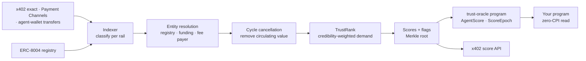

<div align="center">

# Agent Trust Oracle

**Payment-grounded trust scores for Solana agents.**

Index real x402 and payment-channel settlements · strip wash trading and self-dealing · publish verifiable scores that any program can read in one account load.

[](https://github.com/maitreya-ai/AgentTrustOracle/actions/workflows/ci.yml)


[Overview](docs/project-overview.md) · [Architecture](docs/architecture.md) · [Methodology & threat model](docs/methodology.md)

</div>

---

## Why

Raw agent-payment volume is easy to fake. Analysts filtering x402 activity for self-transfers and circular flows found adjusted volume to be a small fraction of raw counts ([Visa–Artemis](https://startupfortune.com/ai-agents-have-moved-over-200-million-payments-on-x402-but-half-may-be-fake/), [Artemis](https://x.com/artemis/status/2031768320081277029)). Feedback-based reputation (ratings) is easy to fake too.

The [Solana Agent Registry](https://solana.com/agent-registry) lists **"DeFi protocols open only to agents with verified reputation scores"** among its intended uses. This oracle supplies that score, built from **the money agents actually earn from credible, unrelated counterparties**.

<table>
<tr><th align="left">Synthetic economy (<code>bun run simulate</code>)</th><th>Raw</th><th>Score</th><th align="left">Why</th></tr>
<tr><td>Honest agent: 20 aged repeat customers</td><td>$10</td><td><b>749</b></td><td>credible, diverse, repeat demand</td></tr>
<tr><td>Wash ring: W → R1 → R2 → W</td><td>$10,000</td><td><b>0</b></td><td><code>CIRCULAR_FLOW</code>: 100% cancelled</td></tr>
<tr><td>Self-dealer: 5 self-funded sock wallets</td><td>$500</td><td><b>0</b></td><td><code>SELF_DEALING</code>: socks clustered by funder</td></tr>
<tr><td>Sybil farm: 30 fresh wallets, one funder</td><td>$150</td><td><b>68</b></td><td>30 wallets → 1 entity, $3.33 credited</td></tr>
</table>

## How it works



- **Money is the signal.** Only settled stablecoin payments count, normalised to µUSD.
- **Net demand, not volume.** Self-dealing and circulating value are removed before anything is credited.
- **Credibility-weighted.** A dollar from an aged wallet that pays many services counts. A dollar from a fresh single-purpose wallet barely does.
- **Griefing-resistant.** Unsolicited payments can never lower a score. Only an agent's own flows can penalise it.
- **Verifiable.** Every epoch commits a Merkle root plus the methodology and inputs hashes. The pipeline is deterministic and reproducible.
- **No new identity silo.** Reads existing registries (8004 today, SATI next) through a pluggable provider.

## Use it from a Solana program

```toml
[dependencies]
trust-oracle-interface = { git = "https://github.com/maitreya-ai/AgentTrustOracle" }
```

```rust
use trust_oracle_interface::{erc8004, load_checked, TrustPolicy};

// 1. The signer controls a registered 8004 agent.
let agent = erc8004::parse_agent(&agent_info.owner.to_bytes(), &agent_info.try_borrow_data()?)
    .ok_or(MyError::NotAnAgent)?;
require!(agent.is_controlled_by(&signer.key().to_bytes()), MyError::NotTheAgent);

// 2. The oracle vouches for it right now. No CPI, no Anchor dependency.
let score = load_checked(&score_info.owner.to_bytes(), &score_info.try_borrow_data()?, &agent.asset)
    .map_err(|_| MyError::BadScoreAccount)?;
TrustPolicy::STANDARD.check(&score, Clock::get()?.slot).map_err(|_| MyError::Untrusted)?;
```

Prefer CPI? Call `assert_trust(policy)`. Need an agent without a score account? Verify a Merkle proof with `verify_score_proof`. See [`examples/trust-gated-vault`](examples/trust-gated-vault/src/lib.rs) and [integration paths](docs/architecture.md#5-integration-paths).

## Use it from TypeScript

```ts
import { createTrustOracleClient, fetchAgentScore, checkTrust, POLICIES } from "@ato/sdk";
import { createX402Fetch } from "@ato/sdk/x402";

// Onchain, free
const score = await fetchAgentScore(rpc, agentId);
const verdict = score && checkTrust(score, POLICIES.STANDARD, currentSlot); // null = trusted

// API, paid per request with x402 (USDC on Solana)
const oracle = createTrustOracleClient({ baseUrl, paidFetch: createX402Fetch(signer) });
const report = await oracle.report(agentId); // components, linked wallets, wash cycles
```

| Route                                                                               | Price  |
| ----------------------------------------------------------------------------------- | ------ |
| `GET /v1/agents/:id/badge` · `/proof` · `/v1/epochs/latest` · `/v1/stats/ecosystem` | free   |
| `GET /v1/agents/:id/score` · `GET /v1/wallets/:address/score`                       | $0.001 |
| `GET /v1/agents/:id/report`                                                         | $0.01  |
| `POST /v1/scores/batch` (≤ 50)                                                      | $0.02  |

## Quick start

Requires [Bun](https://bun.sh) ≥ 1.4 and Rust (via rustup). Postgres comes from Docker or any local server. The Solana/Anchor CLIs are only needed to build and deploy the program.

```bash
bun install
bun run check          # biome + typecheck + 61 TS tests
cargo test --workspace # Rust parity tests (layout, discriminators, Merkle, 864 policy cases)
bun run simulate       # score the synthetic economy

# full stack locally
cp .env.example .env
bun run db:up && bun run db:migrate   # Postgres on :5433
bun run demo:seed                     # synthetic economy into the DB
bun run score                         # compute epoch 1
bun run dev:api                       # http://localhost:8787

# onchain program (needs Agave 4.4 + Anchor 1.2)
anchor build && cargo test -p program-tests   # LiteSVM lifecycle tests
```

Against real chain data: `bun run indexer registry`, then `bun run indexer poll` (or `stream` with Helius LaserStream), then `bun run indexer funding`, then `bun run score`, then `bun run publish-epoch`.

## Repository

```
packages/
  core/       deterministic scoring engine (no Solana deps): entities, cycles, TrustRank, Merkle
  solana/     tx normalisation, x402 / payment-channel / transfer classifiers, 8004 decoder, funding
  db/         Drizzle schema + repository on Bun.SQL
  sdk/        accounts, PDAs, instruction builders, trust policies, proofs, x402 API client
apps/
  indexer/    registry · backfill · poll · stream · funding
  scorer/     computes epoch N = last published + 1
  publisher/  writes epochs + changed scores onchain (only process with a key)
  api/        Hono on Bun, x402-paywalled
programs/trust-oracle/          Anchor 1.2 program
crates/trust-oracle-interface/  no_std, zero-dependency reader for other programs
examples/trust-gated-vault/     integrator example
tests/program/                  LiteSVM lifecycle tests
fixtures/                       cross-language parity vectors (TS → Rust)
docs/                           overview · architecture · methodology & threat model
```

## Devnet deployment

|             |                                                                                                                                                   |
| ----------- | ------------------------------------------------------------------------------------------------------------------------------------------------- |
| Program     | [`2amJRdRNf4XyNGYH2gc4sQyvmKBQVN62pieHmSvMo3HJ`](https://explorer.solana.com/address/2amJRdRNf4XyNGYH2gc4sQyvmKBQVN62pieHmSvMo3HJ?cluster=devnet) |
| Config PDA  | `["config"]`. Admin and publisher keys are separate; the admin is the upgrade authority                                                           |
| First epoch | Root `7137bace…`, covering 4,918 agents (4,917 synced from the devnet 8004 registry)                                                              |

What has run end to end on devnet:

1. Registry sync decoded all 4,917 live 8004 `AgentAccount`s (748 bytes each).
2. The API took **real x402 payments** (402 challenge → USDC `TransferChecked` sponsored by the PayAI facilitator).
3. The indexer classified those settlements as `x402_exact`, with facilitator and memo.
4. The scorer committed epoch 1, and the publisher wrote `publish_epoch` + `upsert_score`.
5. A consumer read the `AgentScore`, verified its leaf against the onchain root, landed `verify_score_proof` + `assert_trust`, and saw `assert_trust(STANDARD)` rejected with `ScoreTooLow`.

Reproduce:

```bash
bun run oracle status                                   # config + latest epoch
bun run indexer registry                                # sync 8004 agents
bun run scripts/devnet/pay-api.ts http://localhost:8787 /v1/agents/<id>/score 2
INDEXER_EXTRA_ADDRESSES=<payTo> bun run indexer backfill
bun run score && PUBLISHER_DRY_RUN=false bun run publish-epoch
bun run scripts/devnet/verify-onchain.ts <agent>
```

## Status

The MVP is deployed and running end to end on devnet. Next: mainnet read-only indexing over gRPC, calibration on real traffic, and a mainnet deploy behind a Squads multisig. See the [MVP plan](docs/project-overview.md#mvp-plan-46-weeks) and the [roadmap](docs/project-overview.md#roadmap-after-the-mvp), which includes staked multi-publisher attestation, a zk proof of scoring, write-back to the 8004 Reputation Registry, and an MCP tool for agents.
