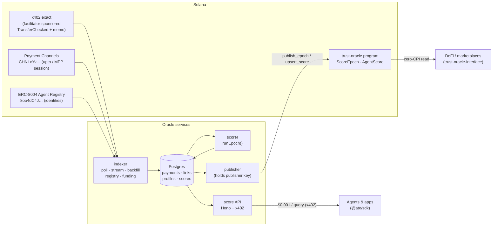
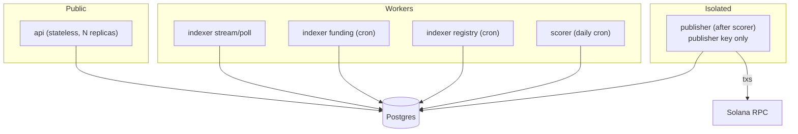

# Architecture

Agent Trust Oracle turns settled agent payments on Solana into trust scores that other programs can read in a single account load. This document covers how data moves through the system, what lives onchain, how scores can be independently verified, and how integrators consume them.

For _how a score is computed_, see [methodology.md](methodology.md). For _why the project exists_, see [project-overview.md](project-overview.md).

---

## System at a glance



Each service is a separate Bun process with one job. Only the **publisher** holds a signing key. The **scorer** is a pure function of the database contents. The **API** and **indexer** hold no keys that can move value.

| Component       | Path                            | Role                                                                                                                                                    |
| --------------- | ------------------------------- | ------------------------------------------------------------------------------------------------------------------------------------------------------- |
| Scoring engine  | `packages/core`                 | Deterministic pipeline: entity resolution → cycle cancellation → TrustRank → scores → Merkle commitments. No Solana dependency.                         |
| Chain adapters  | `packages/solana`               | Normalises transactions (RPC JSON and Yellowstone gRPC into one shape), classifies payments per rail, decodes 8004 identities, resolves wallet funding. |
| Storage         | `packages/db`                   | Drizzle schema and repository on Bun's native Postgres client.                                                                                          |
| Client SDK      | `packages/sdk`                  | Account decoders, PDAs, instruction builders, trust policy checks, Merkle proof verification, x402 API client.                                          |
| Indexer         | `apps/indexer`                  | `registry` · `backfill` · `poll` · `stream` · `funding` commands.                                                                                       |
| Scorer          | `apps/scorer`                   | Computes epoch _N = last published + 1_ and stores scores, proofs and the root.                                                                         |
| Publisher       | `apps/publisher`                | Writes the epoch commitment and changed scores onchain.                                                                                                 |
| API             | `apps/api`                      | Free badges, proofs and ecosystem stats. Paid scores and reports via x402.                                                                              |
| Program         | `programs/trust-oracle`         | Anchor 1.2 program: config, epochs, per-agent scores, `assert_trust`, `verify_score_proof`.                                                             |
| Interface crate | `crates/trust-oracle-interface` | `no_std`, zero-dependency reader for other programs (Anchor, Pinocchio, native).                                                                        |
| Example         | `examples/trust-gated-vault`    | Integrator sample: "signer is a registered agent AND trusted", in two account reads.                                                                    |

---

## 1. Ingestion

### What counts as a payment

Every classified payment is a stablecoin movement from an economic **payer wallet** to a **payee wallet**. Token accounts and escrow PDAs are always resolved to their owners. v1 counts USDC, USDT and PYUSD at 1:1, normalised to micro-USD.

Classification is a pure function, `classifyTransaction(tx, ctx)` in `packages/solana/src/classify.ts`. It runs three passes in priority order, and each token-transfer instruction is attributed to at most one rail.

**Payment channels** (`CHNLxYvVA28MJP9PrFuDXccuoGXAx7jBacfLEkahyGsX`)

- `distribute` (discriminator `7`) is where money moves. Account 1 is the channel `payer`. Inner transfers out of the escrow ATA (account 3) to anything other than the payer refund ATA (4) or treasury (6) are payouts. Each payout becomes `payer → owner(recipient ATA)`.
- When payouts are batched through SPL Token's batch CPI, the classifier falls back to token-balance deltas. That's only unambiguous with a single `distribute` in the transaction; otherwise the payout is logged as unattributed.
- `open` (discriminator `1`) yields link evidence when a third party pays the channel rent (`rent_payer ≠ payer`).

**x402 `exact`** (spec: `x402-foundation/x402/specs/schemes/exact/scheme_exact_svm.md`)

- Only compute-budget, SPL Token / Token-2022, ATA, Memo and Lighthouse programs appear at top level.
- At least one `TransferChecked`.
- **Fee-payer isolation:** the sponsor appears in no non-ATA instruction and is never the transfer authority.
- The sponsor is a known facilitator _or_ a memo is present. A sponsored transfer with neither is treated as a gasless-wallet relay, not x402.

**Direct transfers**

- Any remaining stablecoin transfer touching a registered agent wallet. This covers MPP `charge` and plain agent-to-agent payments.
- When a non-facilitator pays the fees for someone else's transfer, that yields a `fee_payer` link.

**Close-account rent destinations** among payment participants become `close_destination` links.

Known facilitator fee payers (`packages/solana/src/facilitators.ts`) are labels _and_ infrastructure. They sponsor thousands of unrelated payers, so they are never used as clustering evidence.

### Sources

| Mode        | Command            | Use                                                                                                                       |
| ----------- | ------------------ | ------------------------------------------------------------------------------------------------------------------------- |
| RPC poll    | `indexer poll`     | Tails every watched address (`getSignaturesForAddress` → `getTransaction`), with per-address cursors. Works with any RPC. |
| gRPC stream | `indexer stream`   | Helius LaserStream (Yellowstone-compatible) subscription on the watched set, normalised via `fromGeyser`.                 |
| Backfill    | `indexer backfill` | Pages history back to the cursor.                                                                                         |
| Registry    | `indexer registry` | `getProgramAccounts` on the 8004 registry, filtered by the `AgentAccount` discriminator.                                  |
| Funding     | `indexer funding`  | Walks each new wallet to its first transaction and records the first funder and age.                                      |

The watched set is the payment-channels program, the known facilitator fee payers (mainnet), any `INDEXER_EXTRA_ADDRESSES`, and optionally every registered agent wallet.

> **Scale note.** Facilitators sign millions of transactions a month, so a full mainnet history backfill over public RPC is not realistic. For history, use an archival provider (Helius `getTransactionsForAddress`) or Substreams. [`x402-solana-pulse`](https://github.com/PaulieB14/x402-solana-pulse) already implements x402 detection as a Substreams module and is a natural backfill source. Live traffic belongs on gRPC.

### Identity

The oracle runs **no identity system of its own**. `IdentityProvider` (`packages/solana/src/registry/types.ts`) reads existing registries.

The v1 provider decodes the QuantuLabs 8004 `AgentAccount` (PDA `["agent", asset]`). The agent id is the Metaplex Core asset. Its wallets are the signature-verified `agent_wallet`, falling back to the NFT `owner` when none is set. `owner`, `creator` and `parent_asset` become entity-link evidence.

SATI and any host network's identity layer plug in behind the same interface.

---

## 2. Scoring

The scorer loads a 30-day window and calls `runEpoch(input, methodology)`. In summary:

1. **Entity resolution.** Union-find over link evidence (registry ownership, funding, fee sponsorship, rent, close destinations). Hub fan-out caps keep CEX hot wallets and platforms from merging their users.
2. **Self-dealing removal.** Payments inside one entity are not revenue.
3. **Cycle cancellation.** Circulating value is removed, shortest loops first. Tight loops are wash rings and are penalised; loose, incidental loops are only excluded.
4. **TrustRank.** Personalised PageRank on the net payer→payee graph, seeded by aged wallets that pay several unrelated services. A payer's credibility weights what its money counts for.
5. **Score.** Credited volume, effective payers, repeat payers, longevity and trust are combined, then penalised by the self-dealing and wash share. Flags explain the result.
6. **Commit.** A Merkle tree over every agent's leaf, plus `methodologyHash` and `inputsHash`.

The full specification and threat model are in [methodology.md](methodology.md).

---

## 3. Onchain program

Program id `2amJRdRNf4XyNGYH2gc4sQyvmKBQVN62pieHmSvMo3HJ` (localnet/devnet keypair; regenerate with `bun run program:keys` before your own deploy).

### Accounts

| Account        | PDA seeds                 | Purpose                                                                                                                    |
| -------------- | ------------------------- | -------------------------------------------------------------------------------------------------------------------------- |
| `OracleConfig` | `["config"]`              | `admin` (governance, two-step handover), `publisher` (rotatable hot key), `paused`, `latest_epoch`, `methodology_version`. |
| `ScoreEpoch`   | `["epoch", epoch u64 LE]` | Immutable commitment per epoch: `merkle_root`, `methodology_hash`, `inputs_hash`, window, agent count, publisher.          |
| `AgentScore`   | `["score", agent]`        | Materialised score for one agent. Fixed 128 bytes so readers can use offsets.                                              |

`AgentScore` layout (little-endian, borsh, no padding). This is the contract shared by the program, `trust-oracle-interface` and `@ato/sdk`:

| Offset | Size | Field                                               |
| -----: | ---: | --------------------------------------------------- |
|      0 |    8 | discriminator `sha256("account:AgentScore")[..8]`   |
|      8 |    1 | version                                             |
|      9 |    1 | bump                                                |
|     10 |    1 | registry (`0` = 8004, `1` = SATI, `2` = raw wallet) |
|     11 |   32 | agent                                               |
|     43 |    2 | score (0–1000)                                      |
|     45 |    2 | confidence (bps)                                    |
|     47 |    4 | flags                                               |
|     51 |    2 | wash_ratio_bps                                      |
|     53 |    4 | unique_payers (entities)                            |
|     57 |    8 | organic_volume (µUSD)                               |
|     65 |    8 | raw_volume (µUSD)                                   |
|     73 |    8 | epoch                                               |
|     81 |    8 | updated_slot                                        |
|     89 |    8 | updated_at (i64)                                    |
|     97 |    2 | prev_score                                          |
|     99 |    2 | methodology_version                                 |
|    101 |   27 | reserved                                            |

### Instructions

| Instruction                      | Signer                    | Notes                                                                                                              |
| -------------------------------- | ------------------------- | ------------------------------------------------------------------------------------------------------------------ |
| `initialize`                     | program upgrade authority | Checks `ProgramData.upgrade_authority`, so nobody can front-run setup after deploy.                                |
| `update_config`                  | admin                     | Rotate publisher, pause, bump methodology version.                                                                 |
| `propose_admin` / `accept_admin` | admin / nominee           | Two-step governance handover (use a Squads multisig).                                                              |
| `publish_epoch`                  | publisher                 | Strictly sequential (`epoch == latest + 1`), immutable, bounded window.                                            |
| `upsert_score`                   | publisher                 | `init_if_needed` PDA; range-checked; never overwrites with an older epoch; `prev_score` tracks the previous epoch. |
| `close_score`                    | admin                     | Reclaim rent for agents that left the registry. Their history stays in the roots.                                  |
| `assert_trust`                   | none                      | Fails unless the agent meets a `TrustPolicy`. Usable via CPI or as a guard instruction.                            |
| `verify_score_proof`             | none                      | Verifies any agent's leaf against an epoch root, with or without a materialised account.                           |

Events: `ConfigUpdated`, `AdminProposed`, `AdminTransferred`, `EpochPublished`, `ScoreUpdated`, `ScoreClosed`.

### Why both a Merkle root and per-agent accounts

Rent makes materialising every payee expensive. Each `AgentScore` costs about 0.0018 SOL. The root commits to _every_ scored agent for 32 bytes, and `verify_score_proof` lets any program accept a proof from the API instead of an account.

The publisher only materialises **registered** agents whose score moved materially. Raw-wallet payees (cold-start coverage) stay root-only by default.

---

## 4. Verifiability

The oracle is designed so that nobody has to trust the operator about _how_ a score was produced:

1. **`methodology_hash`** = `sha256(canonical JSON of the Methodology)`. Every tunable is part of the hash. Change one and you have a new methodology.
2. **`inputs_hash`** is a streaming hash over every window payment, link, wallet profile, agent and infrastructure address that fed the epoch.
3. **`merkle_root`** commits to every agent's score fields.
4. `runEpoch` is deterministic: sorted iteration, no clocks or randomness inside. A determinism test runs the same input twice, and an input-order test runs shuffled input.

To audit an epoch, re-index the window from chain data (classification is open source and deterministic), check that you reproduce `inputs_hash`, run `runEpoch` with the published methodology, and compare roots.

Today this is _reproducible_, not _trustless_: a dishonest publisher could commit a bad root, and an auditor would have to notice. See the roadmap for staked attestation and disputes.

---

## 5. Integration paths

**A. Zero-CPI read (cheapest).** Pass the agent's `AgentScore` account and check it with the interface crate:

```rust
use trust_oracle_interface::{load_checked, TrustPolicy};

let view = load_checked(&score_info.owner.to_bytes(), &score_info.try_borrow_data()?, &agent_id)
    .map_err(|_| MyError::BadScoreAccount)?;
TrustPolicy::STANDARD.check(&view, Clock::get()?.slot).map_err(|_| MyError::Untrusted)?;
```

`load_checked` verifies owner, discriminator, size and agent id. Only the oracle can create accounts it owns with that discriminator, and it always derives them at `["score", agent]`, so callers don't re-derive the PDA. `erc8004::parse_agent` lets the same program check that the signer _is_ the agent. See `examples/trust-gated-vault`.

**B. CPI.** Call `assert_trust(policy)` from an Anchor program.

**C. Guard instruction.** Put `assert_trust` in front of a client transaction, so the whole transaction reverts if the counterparty's trust dropped since it was built. Note that x402 `exact` payment transactions cannot carry extra programs; this path is for everything else.

**D. Proof.** For agents without an `AgentScore` account, fetch `GET /v1/agents/:id/proof` and submit `verify_score_proof`. Always check the proof against the **onchain** `ScoreEpoch.merkle_root`, never against the API's copy.

**E. Offchain.** `@ato/sdk` exposes `fetchAgentScore`, `checkTrust` (same semantics as the Rust policy, verified across 864 fixture cases), `verifyScoreProof` and an x402-paying API client.

---

## 6. API

| Route                            | Price  | Returns                                            |
| -------------------------------- | ------ | -------------------------------------------------- |
| `GET /v1/agents/:id/badge`       | free   | tier only                                          |
| `GET /v1/agents/:id/proof`       | free   | leaf fields + Merkle proof                         |
| `GET /v1/epochs/latest`          | free   | root, methodology and inputs hashes                |
| `GET /v1/stats/ecosystem`        | free   | raw vs organic volume, self-dealing, wash, by rail |
| `GET /v1/agents/:id/score`       | $0.001 | score, confidence, flags, volumes                  |
| `GET /v1/wallets/:address/score` | $0.001 | wallet → agent resolution + score                  |
| `GET /v1/agents/:id/report`      | $0.01  | components, features, linked wallets, wash cycles  |
| `POST /v1/scores/batch`          | $0.02  | up to 50 agents                                    |

Paid routes use x402 v2. An unpaid request receives `402` with a base64 `PAYMENT-REQUIRED` challenge (`exact` scheme, USDC on Solana). The client retries with `PAYMENT-SIGNATURE`.

---

## 7. Security model

| Asset               | Control                                                                                              |
| ------------------- | ---------------------------------------------------------------------------------------------------- |
| Program upgrades    | Upgrade authority, intended to sit behind a Squads multisig. `initialize` is bound to it.            |
| Config / governance | `admin` with two-step handover. Can pause and rotate the publisher.                                  |
| Score writes        | `publisher` hot key in an isolated process. Range checks, strictly sequential epochs, no backdating. |
| Score integrity     | Merkle root + methodology and inputs hashes make any tampering detectable.                           |
| Consumers           | Should always enforce `max_age_slots` and `forbidden_flags`, not just `min_score`.                   |

The publisher key can be rotated without redeploying. A compromised publisher can write bad scores until it is rotated, which is why consumers should prefer policies with staleness bounds, and why the roadmap adds multi-publisher attestation.

---

## 8. Cross-language contract and testing

The same bytes are produced in three places: the Anchor program, the Rust interface crate and the TypeScript SDK. `bun run fixtures` writes canonical vectors to `fixtures/`, and Rust tests assert byte equality:

- `AgentScore` serialisation (Anchor `try_serialize` == TS encoder == interface parser)
- account and instruction discriminators
- Merkle leaf encoding, leaf hashes and proofs (`solana-sha256-hasher` onchain == `@noble/hashes` offchain)
- 864 trust-policy decisions (Rust `TrustPolicy::check` == TS `checkTrust`)

| Suite              | Command                                       | Covers                                                                                                                                                                 |
| ------------------ | --------------------------------------------- | ---------------------------------------------------------------------------------------------------------------------------------------------------------------------- |
| TS unit / scenario | `bun test`                                    | Clustering, cycles, TrustRank, Merkle, the full pipeline on a synthetic economy, griefing resistance, classifiers, decoders, API (including a real x402 402 challenge) |
| Rust parity        | `cargo test --workspace`                      | The contract above                                                                                                                                                     |
| Program lifecycle  | `anchor build && cargo test -p program-tests` | LiteSVM: init (real upgrade-authority gate), publish, upsert, gate, pause, unauthorized writes, Merkle proofs                                                          |

---

## 9. Deployment topology



The epoch cadence is daily by default. The scorer and publisher are idempotent: an unpublished epoch is recomputed, never skipped, because epoch numbers are part of every Merkle leaf.
